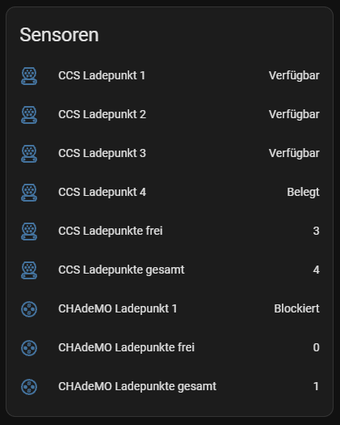
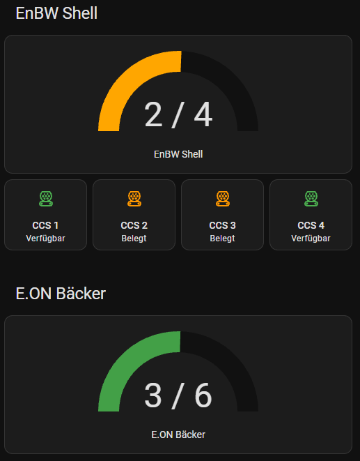

# Ladestationen EnBW

Inoffizielle Home-Assistant-Integration zur Überwachung von Ladestationen im EnBW-Netz.





## Installation

1. In Home Assistant **Einstellungen → Marketplace → Über Link hinzufügen** öffnen.
2. `https://github.com/niro93/ha-ladestationen_enbw` eintragen und als Typ **Integration** auswählen.
3. **Ladestationen EnBW** installieren und Home Assistant neu starten.
4. Unter **Einstellungen → Geräte & Dienste → Integration hinzufügen** nach **Ladestationen EnBW** suchen.

## API-Schlüssel

Der benötigte `Ocp-Apim-Subscription-Key` lässt sich aus der EnBW-Ladekarte auslesen:

1. [EnBW „Unterwegs laden“](https://www.enbw.com/elektromobilitaet/unterwegs-laden) öffnen.
2. Browser-Entwicklertools mit `F12` öffnen und **Netzwerk** auswählen.
3. Eine Ladestation auf der Karte öffnen und in den Anfragen nach `chargestations` suchen.
4. Den Wert von `Ocp-Apim-Subscription-Key` aus den Anforderungsheadern kopieren und in Home Assistant eintragen.

Den Schlüssel nicht öffentlich teilen. Er wird global für alle Stationen gespeichert und kann später über **Konfigurieren** ersetzt werden.

## Funktionen

- Suche anhand einer Adresse im festen Umkreis von 0,5 km
- Sensoren für freie und gesamte CCS-, Typ-2- und CHAdeMO-Ladepunkte sowie den Status einzelner Ladepunkte
- Globales Abfrageintervall: Standard 300 Sekunden, einstellbar von 60 bis 3600 Sekunden
- Standort jeder Station auf einer Home-Assistant-Map-Karte; beim Antippen zeigt der Zustand die verfügbaren Ladepunkte, zum Beispiel `CCS: 3/4 frei`

```yaml
type: map
entities:
  - entity: sensor.<station>_standort
```

## Hinweise

Die Integration ist inoffiziell und nicht mit EnBW verbunden. Die eingegebene Adresse wird einmalig über OpenStreetMap Nominatim geocodiert. Geocodierung: © [OpenStreetMap-Mitwirkende](https://www.openstreetmap.org/copyright).
